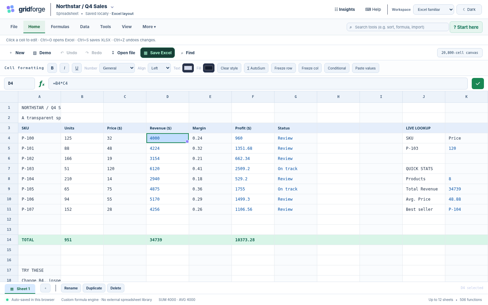

# GridForge v10.3 — Excel-familiar, local-first spreadsheet

> **Verified compatibility progress:** Against saved, user-generated Microsoft Excel 16.0 (build 20430.0) results, GridForge v10.3 now matches **450/456** comparable single-case tests (**98.68%**), compared with **418/456 (91.67%)** in v10.2. **32/34** unexpected differences were resolved without regression among 418 previously matching cases. Two mismatches and four known semantic gaps remain. This is **not** full Excel equivalence. See [repair audit](docs/V10_3_EXCEL_REPAIR_AUDIT.md).

**GDG Tech Wildcard · Frontend Task 2 · TypeScript · MIT**

GridForge is an offline-first browser spreadsheet with a **handwritten TypeScript parser/evaluator**, a virtualized **400 × 52 cell grid**, dependency tracking, formula diagnostics, multi-sheet editing, XLSX/XLSM exchange and optional desktop-Excel VBA integration. Its **506 registered formulas** include functions with narrower support than desktop Excel; the custom formula engine has not been replaced with an off-the-shelf library.



## Start with only Python installed

1. Unzip the repository into a folder.
2. Double-click `START_HERE_WINDOWS.bat`, or run `python run_gridforge.py`.
3. Open the displayed local URL (usually `http://127.0.0.1:4174`).
4. Click a cell to edit, type `=SUM(B4:B11)` for a formula, use **Ctrl+O** for Excel import, **Ctrl+S** for XLSX export, **Ctrl+Shift+S** for JSON backup.

The release includes prebuilt `dist/`; you do **not** need Node.js, npm or pip packages just to run it. Workbook auto-save is browser-origin-local; **export a backup before upgrading, switching ports, or clearing browser data**.

## Easier for Excel / Sheets users

- **Clean Home tab:** Open, Save Excel, Undo/Redo, Find, and familiar cell formatting. File/Formulas/Data/Tools/View/More reveal other commands when needed.
- **Light-first, dark optional:** A persistent user-selectable theme; old saved preferences remain respected.
- **Optional Insights:** Formula Inspector, Impact, What-if and benchmark counters are hidden by default and can be opened with one click. Nothing was deleted.
- **Two workspaces:** Excel familiar and Guided & simple; switching doesn't change the workbook.
- **Editing:** Keyboard navigation, selections, drag fill, paste, undo/redo, right-click, sorting, filtering, conditional formatting, sheet tabs and XLSX import/export.

[Excel / Sheets UI walkthrough](docs/V10_3_EXCEL_SHEETS_UI.md) · [Repair audit](docs/V10_3_EXCEL_REPAIR_AUDIT.md) · [Project handover](docs/V10_3_HANDOVER.md)

## Development, verification and GitHub

Node.js 20+ is needed for development. With the full browser dependencies installed, run:

```powershell
npm install
npm run check
npm test
npm run parity:snapshot
npm run regression
```

For the actual Windows Excel recheck, install `pywin32` into the active Python interpreter (requires installed desktop Excel), then run `python scripts/excel_focus_v10_3.py`. See `docs/V10_3_EXCEL_REPAIR_AUDIT.md`. **VBA does not execute inside the browser.**

The ZIP is a repository root: upload it to GitHub as a normal source repository. `dist/` is intentionally included for a zero-install Python-served launch. GitHub Actions and Pages workflows remain in `.github/workflows`.

## 100 more Excel-style function names

The custom function registry contains **506 unique names**. V10 introduces 100 names spanning probability distributions, finance and coupon dates, matrix/array operations, text, information, and offline-safe data helpers. These are actual callable implementations, with automated fixture tests for all 100, not inert menu entries.

Some names represent **limited Excel-compatible subsets**, not parity with Microsoft Excel: arrays return in-memory matrices and require `INDEX()` (no spill into adjacent cells); `LET`/`LAMBDA` and higher-order functions do not execute full Excel lambda closures; `FORECAST.ETS` currently uses a linear-trend approximation; `IMAGE` returns text instead of a rendered image; offline translation and locale helpers are restricted. Several financial conventions have improved, but specialized bonds and edge cases remain limited. Do not use these limited functions for financial or statistical decisions without comparing outputs against Excel.

```excel
=BETA.DIST(0.5,2,2,TRUE)
=INDEX(SEQUENCE(3,2),2,2)
=INDEX(TEXTSPLIT("red,blue",","),1,2)
=INDEX(FILTER(A2:B4,C2:C4),1,2)
=ISBETWEEN(5,1,10)
=EUROCONVERT(100,"EUR","DEM")
```

- [Complete generated 506-function reference](docs/FUNCTION_REFERENCE.md)
- [v10 new function families and compatibility boundaries](docs/V10_FUNCTIONS_AND_LIMITATIONS.md)
- [v10 gallery: 100 function descriptions and 30 evaluated examples (XLSX)](examples/v10_100_function_reference.xlsx)
- [v10 gallery: native JSON](examples/v10_100_function_reference.json)
- [Bounded missing-function report](docs/V10_EXCEL_FUNCTION_GAP.md)

**Function comparison:** In the **frozen 475-name reference list**, GridForge registers 465 and lacks 10. This is **not** a count of all functions in the latest Microsoft Excel. A registered name does not imply full behavioral equivalence. Source list: `docs/excel_comparison_catalog.json`.

## Development and automated tests

Development requires Node.js **20+** and npm:

```powershell
npm install
npm run dev
```

Complete regression testing also requires Python 3.10+, Playwright and Chromium:

```powershell
python -m pip install playwright
python -m playwright install chromium
npm run regression
```

On Windows, `py -3` may replace `python`; on Linux/macOS `python3` is typical. If Chromium is already installed, set `GRIDFORGE_CHROMIUM` to its executable path. Use `npm run regression:core` for checks that do not require browser dependencies.

At the v10.3 checkpoint: **821/821 unit tests**, **31/31 browser UI checks**, 10,000-formula benchmark, 10,000-cell Data Studio stress test, XLSM binary preservation, bridge validation, and Python-only startup **passed**. The hosted browser could not test storage persistence across a genuine navigation; test that separately in an ordinary browser. Real Windows Excel VBA execution also requires acceptance testing with desktop Excel. See [release evidence](docs/V10_RELEASE_EVIDENCE.md).

## GitHub submission

This ZIP is a repository root: open it directly, do not upload a parent folder. `dist/` is intentionally included for Python-only execution. The CI workflow rebuilds and tests the source, and the Pages workflow is prepared for deployment.

```powershell
git init
git add .
git commit -m "GridForge v10.3: Excel parity repairs and cleaner desktop UI"
git branch -M main
git remote add origin YOUR_GITHUB_REPOSITORY_URL
git push -u origin main
```

See [GitHub publishing guide](docs/GITHUB_RELEASE.md), [security model](docs/SECURITY.md) and [project handover](docs/PROJECT_HANDOVER.md).

## Scope and safety

- **No VBA executes in the browser.** The optional Python bridge invokes trusted macros only via desktop Microsoft Excel on Windows (requires `pywin32`, Excel and explicit approval). Actual Excel VBA execution is not verified in this release environment.
- XLSM round-trips preserve embedded VBA and apply supported cell/formula edits, but advanced workbook changes, formula types, and signatures can be incompatible. Keep originals and validate exported files in Excel.
- Dynamic-array spilling, full formula parity, cross-sheet references, native pivot engine, external OLAP/market feeds, and real-time web-service functions remain unsupported.
- The 100 Data Studio editing actions from v8 and all v9 command groups are retained.

**License:** MIT. No external font files are redistributed.

## Microsoft Excel behavior comparison (v10.1)

For a transparent, repeatable comparison against **real desktop Excel**, use `RUN_EXCEL_PARITY_WINDOWS.bat` on Windows with Excel installed and `pywin32`, or read `docs/EXCEL_PARITY_WINDOWS_GUIDE.md`. A Python-only user can run the provided app and the parity comparison; Node.js is needed only to rebuild TypeScript. The Excel runner is optional and never executes VBA.

```powershell
py -3 -m pip install pywin32
py -3 scripts\excel_parity_desktop.py
py -3 scripts\excel_parity_compare.py
```

The existing application still launches through `START_HERE_WINDOWS.bat` or `python run_gridforge.py`.

## Full 506-function Excel differential audit

This release contains a **506-name fixture manifest** and a new Windows runner for measuring how the GridForge formula engine compares against installed Microsoft Excel. It supplements the earlier 140-case parity sample without replacing it.

**Already verified here:** all 506 registered names were exercised through the actual GridForge Workbook evaluator; 505 returned values, `NA()` returned its intentional `#N/A` error, and zero uncaught exceptions occurred. **Actual Excel results are still pending Windows execution.** The updated Node unit suite passes 818/818 tests.

On a Windows computer with Microsoft Excel and `pywin32` installed, run:

```powershell
python scripts\excel_parity_506_desktop.py
python scripts\excel_parity_506_compare.py
```

You can also use `RUN_ALL_506_EXCEL_PARITY_WINDOWS.bat` if your Python environment can already import `win32com.client`.

Read [`docs/PARITY_506_WINDOWS_GUIDE.md`](docs/PARITY_506_WINDOWS_GUIDE.md) for result categories, the three default cloud-function exclusions, limitations, and report paths. `docs/PARITY_506_COVERAGE.csv` lists all names with their exact test formulas. This suite makes **no claim of full Microsoft Excel compatibility** from its one-case-per-function results.
